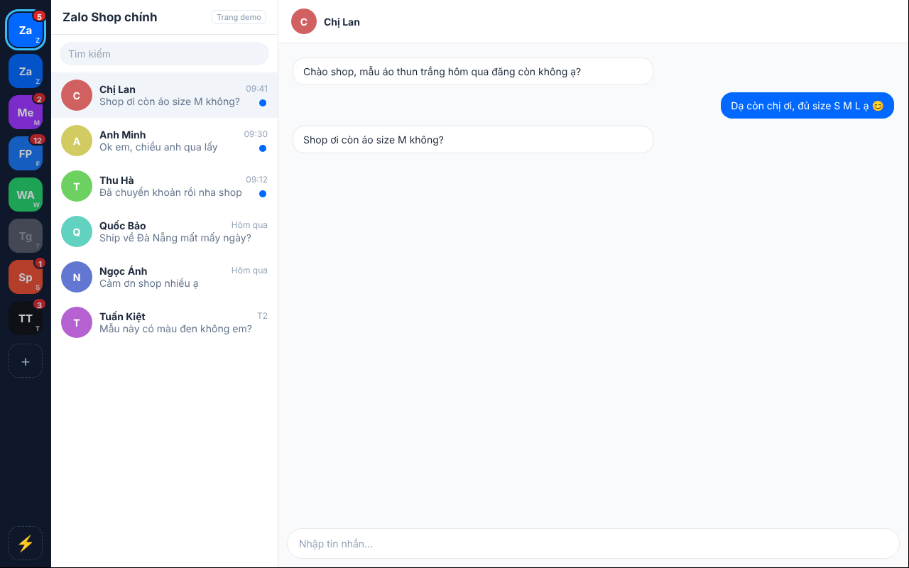
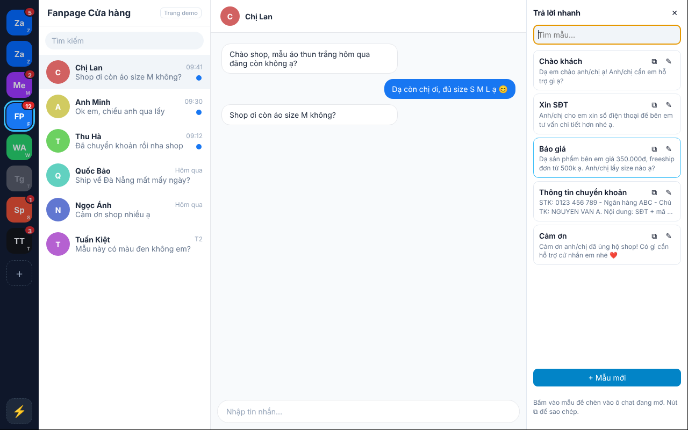
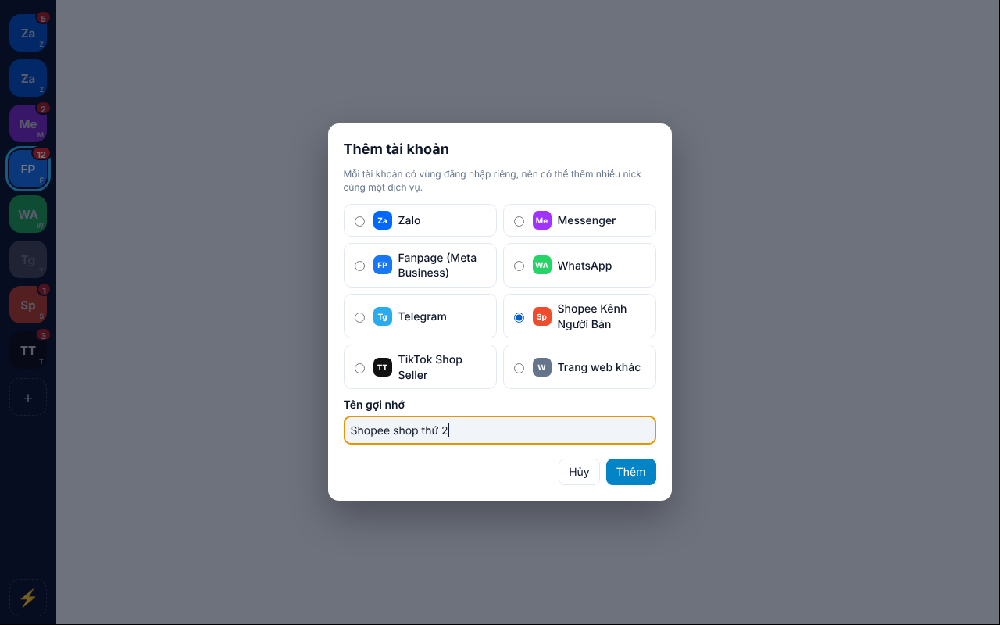
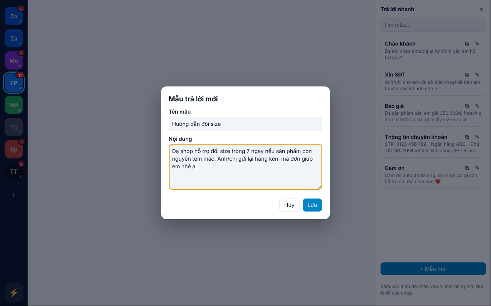
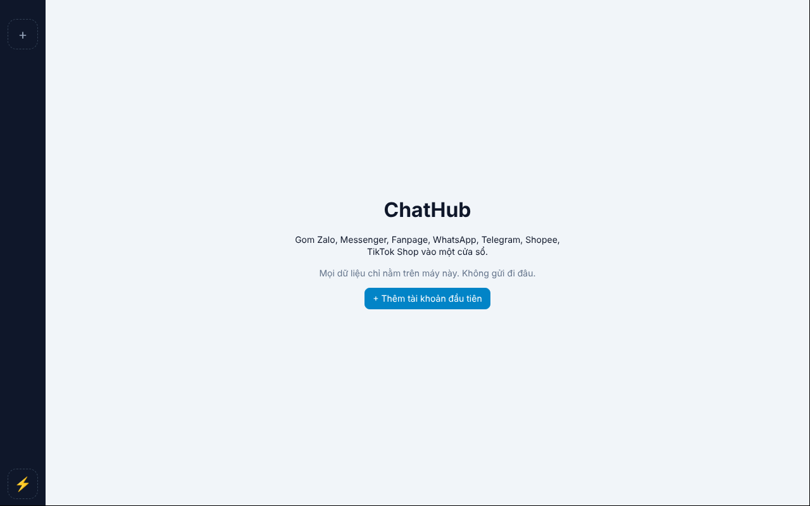
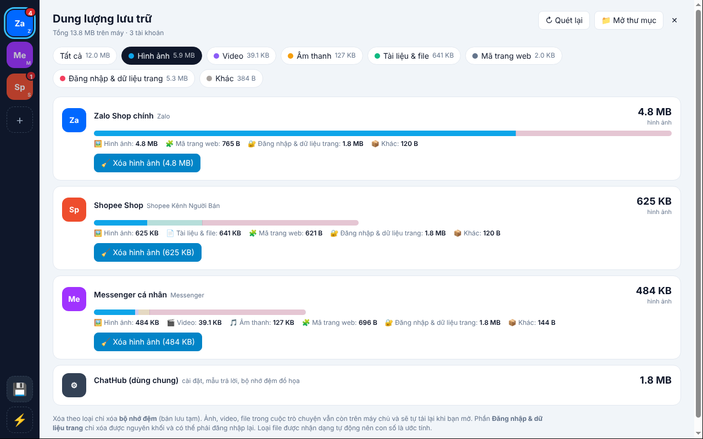

<div align="center">


# ChatHub

**Gom Zalo, Messenger, Fanpage, WhatsApp, Telegram, Shopee, TikTok Shop vào một cửa sổ.**
Nhiều tài khoản, tách biệt hoàn toàn. Mã nguồn mở, không theo dõi, có bản portable không cần cài.

[](https://github.com/AnhBon83/ChatHub/releases/latest)
[](https://github.com/AnhBon83/ChatHub/releases)
[](LICENSE)


[](https://github.com/AnhBon83/ChatHub/releases/latest/download/ChatHub-Windows.zip)
[](https://github.com/AnhBon83/ChatHub/releases/latest/download/ChatHub-Setup.exe)



</div>

---

## Giới thiệu

Bán hàng online thường phải mở cùng lúc Zalo, Messenger, Fanpage, Shopee, TikTok Shop… mỗi thứ một tab,
mỗi nick một trình duyệt. **ChatHub** gom tất cả vào **một cửa sổ duy nhất**: mỗi tài khoản là một icon
bên trái, có số tin chưa đọc, có thông báo, chuyển qua lại bằng một cú bấm.

ChatHub được viết để **dễ kiểm tra**: toàn bộ mã nguồn chỉ khoảng 1.200 dòng, không có thư viện lạ,
không gửi dữ liệu đi đâu. File cài đặt được **GitHub tự build công khai từ chính mã nguồn này**
(xem tab [Actions](https://github.com/AnhBon83/ChatHub/actions)), không ai build tay trên máy riêng.

## Tính năng

| | |
|---|---|
| 💬 **7 dịch vụ có sẵn** | Zalo, Messenger, Fanpage (Meta Business Suite), WhatsApp, Telegram, Shopee Kênh Người Bán, TikTok Shop — và **bất kỳ trang web nào** khác |
| 👥 **Nhiều nick cùng dịch vụ** | Mỗi tài khoản có vùng đăng nhập riêng (cookie tách biệt), thêm bao nhiêu nick Zalo / Facebook cũng được |
| 🔴 **Đếm tin chưa đọc** | Số đỏ trên từng icon và trên thanh taskbar |
| 🔔 **Thông báo desktop** | Nhận thông báo tin mới kể cả khi đang ở tài khoản khác |
| ⚡ **Trả lời nhanh** | Lưu sẵn mẫu tin (chào khách, báo giá, số tài khoản…), bấm một cái là chèn vào ô chat |
| 💾 **Quản lý dung lượng** | Xem mỗi tài khoản chiếm bao nhiêu dung lượng, **lọc theo hình ảnh, video, âm thanh, tài liệu & file**…, xóa theo từng loại cho từng tài khoản |
| 😴 **Chế độ ngủ** | Tắt tạm nick ít dùng để tiết kiệm RAM |
| 🎒 **Bản portable** | Một file ZIP, giải nén là chạy, không cần cài, **không cần quyền admin**, dữ liệu nằm cạnh file — mang theo USB được |
| ⌨️ **Phím tắt** | `Ctrl+1…9` chuyển tài khoản · `Ctrl+R` tải lại · `Ctrl +/-/0` phóng to, thu nhỏ |

## Hình ảnh

<table>
<tr>
<td width="50%"><p align="center"><b>Trả lời nhanh</b> — bấm mẫu là chèn vào ô chat</p></td>
<td width="50%"><p align="center"><b>Thêm tài khoản</b> — chọn dịch vụ, đặt tên gợi nhớ</p></td>
</tr>
<tr>
<td width="50%"><p align="center"><b>Tạo mẫu trả lời</b> của riêng bạn</p></td>
<td width="50%"><p align="center"><b>Lần đầu mở app</b></p></td>
</tr>
<tr>
<td colspan="2"><p align="center"><b>Quản lý dung lượng</b> — xem và xóa theo từng tài khoản, lọc theo hình ảnh, video, âm thanh, tài liệu…</p></td>
</tr>
</table>

> Ảnh minh họa dùng trang chat demo để không lộ dữ liệu khách hàng thật. Khi dùng thật, bạn sẽ thấy
> đúng giao diện web của Zalo, Messenger… như khi mở trên trình duyệt.

## Tải về & cài đặt

ChatHub có **2 phiên bản cho Windows**. Bấm nút là tải ngay bản mới nhất:

<table>
<tr>
<th width="50%">🎒 Bản Portable <sub>(khuyên dùng)</sub></th>
<th width="50%">💿 Bản Cài đặt</th>
</tr>
<tr>
<td align="center">

[](https://github.com/AnhBon83/ChatHub/releases/latest/download/ChatHub-Windows.zip)

`ChatHub-Windows.zip` · 1 file duy nhất

</td>
<td align="center">

[](https://github.com/AnhBon83/ChatHub/releases/latest/download/ChatHub-Setup.exe)

`ChatHub-Setup.exe` · ~120 MB

</td>
</tr>
<tr>
<td valign="top">

- **1 file ZIP duy nhất**: giải nén là chạy, **không cần cài**
- **Không cần quyền admin** — dùng được trên máy công ty
- Dữ liệu nằm trong thư mục `ChatHub-data` **ngay cạnh file .exe**, không ghi gì vào máy
- Mang theo **USB**, chạy trên máy nào cũng được
- Xóa thư mục là xóa sạch, không để lại dấu vết

**Phù hợp:** máy công ty, máy dùng chung, muốn mang theo người.

</td>
<td valign="top">

- Cài như phần mềm bình thường, có **icon ở Start Menu và Desktop**
- Tìm app nhanh bằng ô tìm kiếm của Windows
- Cài cho riêng tài khoản Windows của bạn, thường **không cần admin**
- Gỡ trong *Settings → Apps* như mọi phần mềm khác
- Dữ liệu lưu ở `%APPDATA%\ChatHub`

**Phù hợp:** máy cá nhân, dùng hằng ngày.

</td>
</tr>
<tr>
<td valign="top">

**Cách dùng**
1. Chuột phải `ChatHub-Windows.zip` → **Extract All…** → chọn nơi giải nén (VD `D:\` hoặc USB).
2. Mở thư mục `ChatHub` vừa giải nén → bấm đúp **`ChatHub.exe`**.
3. Muốn có icon ngoài Desktop: chuột phải `ChatHub.exe` → *Send to → Desktop (create shortcut)*.
4. Mang sang máy khác: chép **cả thư mục `ChatHub`** — các tài khoản vẫn còn đăng nhập.

Trong thư mục có sẵn file `HUONG-DAN.txt` hướng dẫn nhanh.

</td>
<td valign="top">

**Cách dùng**
1. Bấm đúp `ChatHub-Setup.exe`.
2. Chọn thư mục cài (hoặc để mặc định) → **Install**.
3. Mở ChatHub từ Start Menu hoặc icon ngoài Desktop.
4. Cập nhật: tải bản Setup mới và cài đè, dữ liệu giữ nguyên.

</td>
</tr>
</table>

> **Cảnh báo "Windows protected your PC" lần đầu mở?** Bình thường — app chưa mua chứng chỉ ký số
> (vài trăm USD/năm). Bấm **More info → Run anyway**. Muốn chắc chắn file không bị sửa, hãy
> [kiểm tra mã SHA256](#kiểm-tra-file-tải-về) hoặc [tự build từ mã nguồn](#tự-build-từ-mã-nguồn).

**Muốn đúng 1 file `.exe` thay vì ZIP?** [Tải `ChatHub-Portable.exe`](https://github.com/AnhBon83/ChatHub/releases/latest/download/ChatHub-Portable.exe) — chạy y như bản ZIP,
nhưng mỗi lần mở mất thêm vài giây để tự giải nén.

**Hệ điều hành khác:** Linux — [tải `ChatHub.AppImage`](https://github.com/AnhBon83/ChatHub/releases/latest/download/ChatHub.AppImage) rồi `chmod +x ChatHub.AppImage && ./ChatHub.AppImage`.
macOS — [tự build từ mã nguồn](#tự-build-từ-mã-nguồn).
Các phiên bản cũ và ghi chú thay đổi: xem trang [Releases](https://github.com/AnhBon83/ChatHub/releases).

### Cách dùng

1. Mở app → bấm **+ Thêm tài khoản** → chọn dịch vụ → đặt tên (VD: *Zalo shop chính*).
2. Đăng nhập như trên web (Zalo / WhatsApp quét QR bằng điện thoại).
3. Muốn thêm nick khác: bấm **+** ở thanh bên trái.
4. **Chuột phải** vào icon tài khoản để: tải lại, đổi tên, sắp xếp, cho ngủ, xóa.
5. Bấm **⚡** để mở bảng trả lời nhanh.
6. Bấm **💾** để xem dung lượng và dọn dẹp (xem bên dưới).

### Quản lý dung lượng

Bấm **💾** ở thanh bên trái để xem mỗi tài khoản đang chiếm bao nhiêu dung lượng trên máy.

- **Lọc theo loại:** Tất cả · Hình ảnh · Video · Âm thanh · Tài liệu & file · Mã trang web · Đăng nhập & dữ liệu trang · Khác.
  Danh sách tự sắp xếp tài khoản tốn nhiều dung lượng nhất (theo loại đang lọc) lên đầu.
- **Xóa theo loại cho từng tài khoản**, VD chỉ xóa *hình ảnh* của *Zalo Shop chính*. Phần này nằm trong **bộ nhớ đệm**:
  xóa xong bạn **vẫn đăng nhập**, ảnh/video/file trong cuộc trò chuyện **không mất** — trang tự tải lại từ máy chủ khi cần.
- **Xóa bộ nhớ đệm** (lọc *Tất cả*): dọn mọi bản lưu tạm của tài khoản đó.
- **Xóa dữ liệu trang**: dọn dữ liệu offline của trang (IndexedDB, Local Storage…). Giải phóng nhiều hơn nhưng **có thể phải đăng nhập lại**.
- **Mở thư mục**: mở nơi lưu dữ liệu ChatHub trên máy.

> Loại file được nhận dạng tự động từ nội dung (trình duyệt không lưu file kèm đuôi `.jpg`, `.mp4`…), nên con số là ước tính.
> File đang được trang sử dụng sẽ tự xóa ở lần mở app sau.

## Bảo mật & quyền riêng tư

Lý do ChatHub ra đời là để **không phải tin vào một file .exe không rõ nguồn gốc** khi đưa các tài khoản bán hàng vào.

- ❌ **Không** telemetry, analytics, quảng cáo, auto-update, không tải code từ server nào.
  App chỉ kết nối tới đúng các trang chat bạn thêm vào.
- 🔒 Trang chat chạy trong **sandbox**, `contextIsolation` bật, **không có quyền Node.js** — không đọc được file trên máy.
- 🔒 **Không chèn script** vào Zalo / Facebook… Số tin chưa đọc lấy từ tiêu đề trang (VD: `(3) Messenger`).
- 🔒 Chỉ cấp quyền: thông báo, micro/camera (ghi âm, gọi), ghi clipboard, toàn màn hình. Vị trí, USB, Bluetooth… đều bị từ chối.
- 🔒 Link ra ngoài mở bằng trình duyệt mặc định; giao thức lạ (`bytedance://`, `file://`…) bị chặn.
- 🔒 Chỉ 2 thư viện chính chủ: `electron` và `electron-builder`, phiên bản ghim cứng.
- 🔒 File cài đặt build tự động trên GitHub Actions từ mã nguồn công khai — ai cũng xem được quá trình build.

**Dữ liệu lưu ở đâu?** Chỉ trên máy bạn:

| Bản | Thư mục dữ liệu |
|---|---|
| Portable (ZIP hoặc 1 file .exe) | Thư mục `ChatHub-data` nằm **cạnh file .exe** |
| Cài đặt (Windows) | `%APPDATA%\ChatHub` |
| Linux | `~/.config/ChatHub` |
| macOS | `~/Library/Application Support/ChatHub` |

> ⚠️ Thư mục này chứa phiên đăng nhập, giống như dữ liệu của Chrome. Ai có nó là dùng được các tài khoản
> của bạn. Đừng chia sẻ, và xóa nó khi thôi dùng trên máy công ty / máy dùng chung.

### Kiểm tra file tải về

Mở PowerShell ở thư mục chứa file và chạy:

```powershell
Get-FileHash .\ChatHub-Windows.zip -Algorithm SHA256
```

So kết quả với dòng tương ứng trong [`SHA256SUMS.txt`](https://github.com/AnhBon83/ChatHub/releases/latest/download/SHA256SUMS.txt) (bấm để tải). Trùng khớp = file nguyên vẹn.

## Tự build từ mã nguồn

Cần [Node.js](https://nodejs.org) bản LTS (20 trở lên).

```bash
git clone https://github.com/AnhBon83/ChatHub.git
cd ChatHub
npm install
npm start                 # chạy thử
npm run build:portable    # -> dist/ChatHub-Portable.exe
npm run build:win         # -> dist/ChatHub-Setup.exe
npm run build:linux       # -> dist/ChatHub.AppImage
npm run build:mac         # -> dist/ChatHub.dmg (chạy trên máy Mac)
```

### Phát hành phiên bản mới (dành cho người duy trì)

1. Tăng `version` trong `package.json` (VD: `1.0.1`) và thêm mục `## [1.0.1] - ngày` vào `CHANGELOG.md`.
2. Đẩy lên nhánh `main`.
3. Vào tab **Actions → Release → Run workflow**. Khoảng 10 phút sau, trang Releases có bản mới kèm file `.exe`, `.AppImage` và `SHA256SUMS.txt`. Các nút tải trong README tự trỏ tới bản mới nhất.

### Cấu trúc mã nguồn

| File | Vai trò |
|---|---|
| [`src/main.js`](src/main.js) | Tiến trình chính: cửa sổ, tách session từng tài khoản, chính sách bảo mật |
| [`src/storage.js`](src/storage.js) | Quét, phân loại (ảnh, video…) và xóa dung lượng của từng tài khoản |
| [`src/services.js`](src/services.js) | Danh sách dịch vụ — thêm dịch vụ mới chỉ cần thêm vài dòng |
| [`src/preload.js`](src/preload.js) | Cầu nối an toàn cho thanh bên (không nạp vào trang chat) |
| [`src/renderer/`](src/renderer) | Giao diện thanh bên, hộp thoại, trả lời nhanh |
| [`.github/workflows/release.yml`](.github/workflows/release.yml) | Tự build & phát hành khi có phiên bản mới |

## Câu hỏi thường gặp

**Có bị khóa nick không?** ChatHub chỉ mở bản web chính thức của từng dịch vụ, giống hệt bạn mở bằng Chrome —
không tự động nhắn tin, không spam, không cào dữ liệu.

**Trang X không vào được / bị đổi địa chỉ?** Chuột phải icon → *Về trang chủ dịch vụ*. Nếu vẫn lỗi,
thêm bằng mục *Trang web khác* với địa chỉ đúng, và [báo lỗi tại đây](https://github.com/AnhBon83/ChatHub/issues).

**Zalo / WhatsApp đòi quét QR lại?** Đó là chính sách hết hạn phiên của họ, không phải lỗi app.

**Dùng trên máy công ty không có quyền admin?** Dùng bản **Portable**. Lưu ý tuân thủ quy định IT của công ty bạn.

## Lịch sử phiên bản

Xem [CHANGELOG.md](CHANGELOG.md).

## Đóng góp

Báo lỗi, đề xuất tính năng: mở [Issue](https://github.com/AnhBon83/ChatHub/issues). Pull request luôn được chào đón.

## Giấy phép

[MIT](LICENSE) © 2026 AnhBon83. Zalo, Messenger, Facebook, WhatsApp, Telegram, Shopee, TikTok là thương hiệu
của các chủ sở hữu tương ứng. ChatHub là dự án độc lập, không liên kết với các công ty này.
