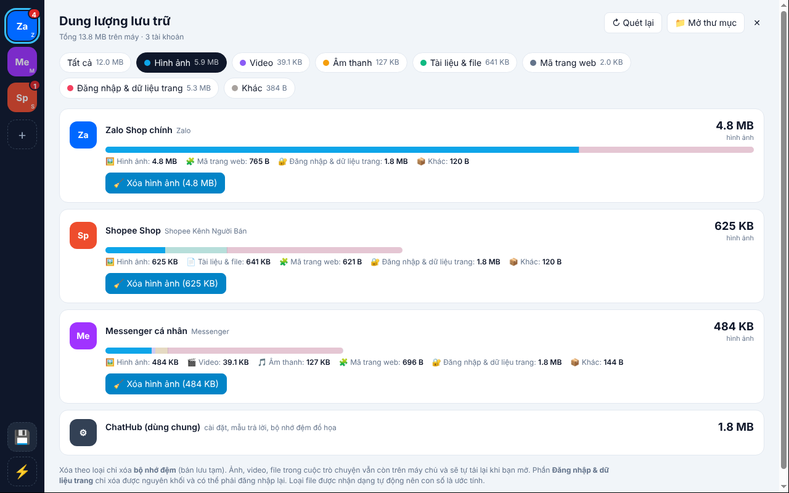

## 💾 ChatHub v1.1.0 — Quản lý dung lượng lưu trữ

Dùng ChatHub lâu ngày, Zalo, Messenger, Shopee… sẽ lưu tạm rất nhiều ảnh, video, file trên máy. Bản cập nhật này giúp bạn **biết tài khoản nào đang chiếm bao nhiêu dung lượng** và **dọn dẹp đúng thứ mình muốn**, ngay trong app.

### ✨ Có gì mới

- **Xem dung lượng từng tài khoản** — bấm nút **💾** ở thanh bên trái. Mỗi tài khoản có thanh biểu đồ màu chia theo loại, tài khoản tốn nhiều nhất hiện lên đầu.
- **Lọc theo loại nội dung**:
  🖼️ Hình ảnh · 🎬 Video · 🎵 Âm thanh · 📄 Tài liệu & file · 🧩 Mã trang web · 🔐 Đăng nhập & dữ liệu trang · 📦 Khác
- **Xóa theo từng loại, cho từng tài khoản** — ví dụ chỉ xóa *hình ảnh* của *Zalo Shop chính*, các tài khoản khác giữ nguyên.
- **Xóa toàn bộ bộ nhớ đệm** của một tài khoản chỉ với một nút.
- **Xóa dữ liệu trang** khi cần giải phóng nhiều hơn (có cảnh báo trước vì có thể phải đăng nhập lại).
- **Mở thư mục dữ liệu** để xem ChatHub lưu gì trên máy.

### 🛡️ Xóa có an toàn không?

| Bạn bấm | Điều gì xảy ra | Còn đăng nhập? | Mất tin nhắn / ảnh? |
|---|---|---|---|
| **Xóa hình ảnh / video / âm thanh / tài liệu** | Xóa bản lưu tạm trên máy, trang tự tải lại từ máy chủ khi cần | ✅ Còn | ❌ Không |
| **Xóa bộ nhớ đệm** | Xóa mọi bản lưu tạm của tài khoản | ✅ Còn | ❌ Không |
| **Xóa dữ liệu trang** | Xóa dữ liệu offline của trang (IndexedDB, Local Storage…) | ⚠️ Có thể phải đăng nhập lại | ❌ Không — tin nhắn vẫn trên máy chủ |

- Dữ liệu đăng nhập **không bao giờ bị xóa lẻ từng file** (tránh làm hỏng trang) — chỉ xóa nguyên khối khi bạn chủ động chọn.
- ChatHub **chỉ xóa trong thư mục dữ liệu của chính nó**, không đụng tới file nào khác trên máy.
- File đang được trang sử dụng (bị Windows khóa) sẽ **tự xóa ở lần mở app sau**, app sẽ báo cho bạn biết.

### 🔄 Cập nhật từ bản cũ (giữ nguyên đăng nhập)

- **Bản ZIP:** tải `ChatHub-Windows.zip`, giải nén rồi chép đè vào thư mục `ChatHub` cũ. **Giữ nguyên thư mục `ChatHub-data`.**
- **Bản cài đặt:** chạy `ChatHub-Setup.exe` mới, cài đè lên bản cũ.
- **Bản 1 file:** thay `ChatHub-Portable.exe` cũ bằng file mới, đặt cùng chỗ với thư mục `ChatHub-data`.

### ⬇️ Tải về

| Bản | Dùng khi nào | Tải |
|---|---|---|
| 🎒 **Portable ZIP** *(khuyên dùng)* | Giải nén là chạy, không cần cài, **không cần quyền admin**, mang theo USB được | [ChatHub-Windows.zip](https://github.com/AnhBon83/ChatHub/releases/download/v1.1.0/ChatHub-Windows.zip) |
| 💿 **Bản cài đặt** | Cài như phần mềm thường, có icon ở Start Menu / Desktop | [ChatHub-Setup.exe](https://github.com/AnhBon83/ChatHub/releases/download/v1.1.0/ChatHub-Setup.exe) |
| 📦 Portable 1 file | Một file `.exe` duy nhất (mở chậm hơn vài giây) | [ChatHub-Portable.exe](https://github.com/AnhBon83/ChatHub/releases/download/v1.1.0/ChatHub-Portable.exe) |
| 🐧 Linux | AppImage | [ChatHub.AppImage](https://github.com/AnhBon83/ChatHub/releases/download/v1.1.0/ChatHub.AppImage) |

Lần đầu mở trên Windows nếu thấy *"Windows protected your PC"*: bấm **More info → Run anyway** (app chưa mua chứng chỉ ký số). Kiểm tra file nguyên vẹn bằng `SHA256SUMS.txt` bên dưới.

### 📝 Lưu ý

- Loại file (ảnh, video…) được nhận dạng tự động từ nội dung, vì trình duyệt không lưu file kèm đuôi `.jpg`, `.mp4`. Con số là **ước tính**.
- Như mọi phiên bản, ChatHub **không gửi dữ liệu đi đâu**, không theo dõi, không tự cập nhật. Toàn bộ file trong trang này được GitHub build công khai từ mã nguồn.

**Thay đổi chi tiết:** [v1.0.1...v1.1.0](https://github.com/AnhBon83/ChatHub/compare/v1.0.1...v1.1.0) · [CHANGELOG.md](https://github.com/AnhBon83/ChatHub/blob/main/CHANGELOG.md)
